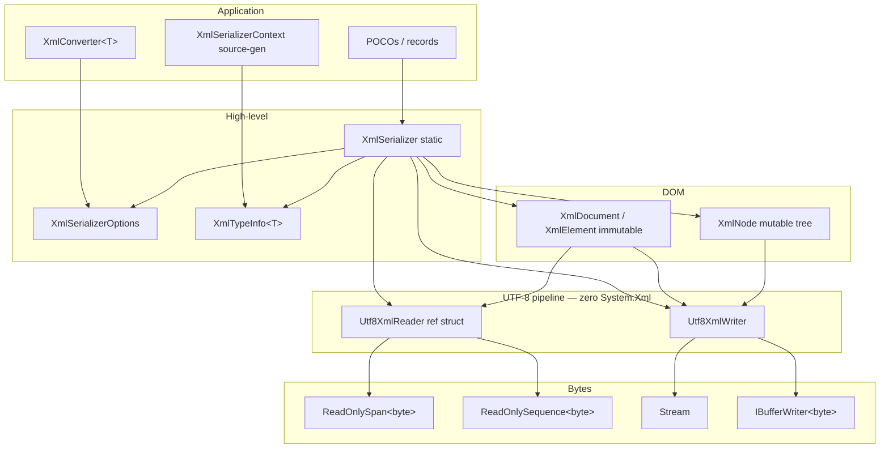
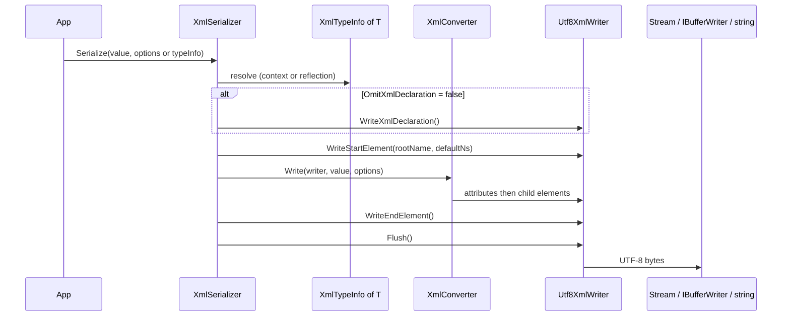
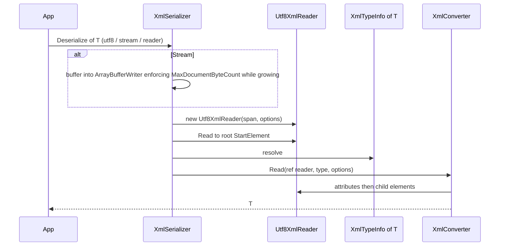

# Proposed design

Part of the [XmlEssentials spec](README.md).

## Layer cake

There is **no** arrow to `System.Xml.*`.

## Serialize sequence

## Deserialize sequence

## Component responsibilities

| Component | Responsibility | Non-responsibility |
| --- | --- | --- |
| `Utf8XmlReader` | Well-formed UTF-8 XML 1.0/1.1 tokenize; version flag; namespace stack; resumable `IsFinalBlock` | Object mapping, runtime XSD validation, DTD |
| `Utf8XmlWriter` | Well-formed UTF-8 emit; escaping; indent; `xsi:nil`; xmlns | Mapping |
| `XmlDocument`/`XmlElement` | ArrayPool-rented immutable parse tree (STJ `JsonDocument`/`JsonElement`) | Mutation; document-instance cache |
| `XmlNode` tree | Mutable DOM with namespaces and mixed children | Mapping |
| `XmlSerializer` | POCO graph ↔ XML via `XmlTypeInfo` | Parsing (delegates to reader) |
| Source generator | `XmlTypeInfo<T>` + serialize/deserialize implementations | Runtime reflection |

DoS limits: [XML fidelity](02-xml-fidelity.md#dos-limits-defaults). Null/root: [object mapping](09-object-mapping.md). Namespace stack + **state snapshot**: [Utf8XmlReader](04-api-reader.md#xmlreaderstate-implementation-contract). Writer escaping: [Utf8XmlWriter](05-api-writer.md#writer-escaping).

## Async and streaming

- **Reader:** resumable. `IsFinalBlock=false` + incomplete token → `Read()` returns false; caller saves `CurrentState` and feeds the next buffer. `CurrentState` is an **opaque snapshot** (element stack, xmlns scopes as copied strings, partial token, positions) — not `Options` alone. Token-spanning `ReadOnlySequence` uses `HasValueSequence` / `ValueSequence`.
- **Serializer async from `Stream`:** object graph = buffer-then-parse (STJ `DeserializeAsync`). **Checking `MaxDocumentByteCount` on each grow.**
- **Serializer async to `Stream`:** `Utf8XmlWriter` on the stream, `FlushAsync`.
- **`IAsyncEnumerable`:** `DeserializeAsyncEnumerable` / `SerializeAsyncEnumerable` (STJ net11, including `topLevelValues`). XML: `false` = children of one document element; `true` = successive documents in the stream.
- **`PipeReader` / `PipeWriter`:** same shapes as STJ net11.

---

[Index](README.md) · [Previous: XML fidelity](02-xml-fidelity.md) · [Next: Utf8XmlReader](04-api-reader.md)
