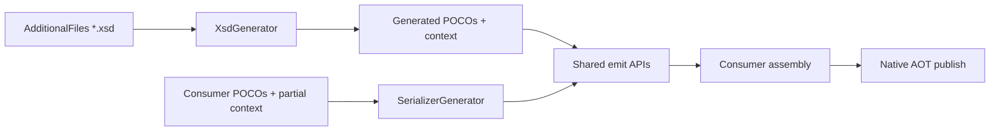

# Source generation

Part of the [XmlEssentials spec](README.md).

Context types and `[XmlSerializable]` / `[XmlSourceGenerationOptions]` signatures: [XmlSerializer](07-api-serializer.md#type-info--context).

## Serialization vs Metadata (STJ terms)

STJ’s source generator has two modes (`JsonSourceGenerationMode`). XmlEssentials uses the same split (`XmlSourceGenerationMode`):

| Mode | What the generator emits | Runtime |
| --- | --- | --- |
| **Serialization** | Concrete serialize and deserialize methods that call `Utf8XmlWriter` / `Utf8XmlReader` with no reflection. Also emits `XmlTypeInfo<T>` properties so `XmlSerializer.Serialize(value, AppXmlContext.Default.Person)` works. | Fast path. Required for Native AOT. |
| **Metadata** | `XmlTypeInfo<T>` metadata only (property list, converters, root name, create-object). The **runtime** library then drives serialize/deserialize from that metadata. | Smaller generated source; still needs the runtime mapper. |
| **Default** | `Metadata \| Serialization` (STJ). Emit both. |

Both modes ship ([K41](01-identity-and-decisions.md#key-decisions)). Interceptors ([K42](01-identity-and-decisions.md#key-decisions)): when a context is in the compilation, intercept `XmlSerializer.Serialize`/`Deserialize` overloads that take options (or default) and rewrite to the generated type-info overload.

## Project

- Path: `src/CloudNimble.XmlEssentials.SourceGeneration/`
- TFM: `netstandard2.0` (Roslyn host compatibility).
- `IsPackable=false`. Packed **inside** `XmlEssentials`.
- `IsSourceGeneratorProject=true` (must be excluded from `IsPrimaryProject` so props do not `GeneratePackageOnBuild` as `XmlEssentials.SourceGeneration`).
- Incremental `IIncrementalGenerator`.
- `IsRoslynComponent=true`.
- `Microsoft.CodeAnalysis.CSharp` 4.* (Roslyn 4.14+ for net10/net11 SDK).
- No dependency on the runtime assembly at generator compile time if that creates a cycle; share **contracts via well-known type names** (the generator emits code that references `CloudNimble.Text.Xml.*`). Optional `CloudNimble.XmlEssentials.SourceGeneration.csproj` `ProjectReference` to the runtime with `ReferenceOutputAssembly=false` is **not** required.

## Nupkg layout

```
XmlEssentials.{version}.nupkg
  lib/net10.0/CloudNimble.XmlEssentials.dll
  lib/net10.0/CloudNimble.XmlEssentials.xml
  lib/net11.0/CloudNimble.XmlEssentials.dll
  lib/net11.0/CloudNimble.XmlEssentials.xml
  analyzers/dotnet/cs/CloudNimble.XmlEssentials.SourceGeneration.dll
  analyzers/dotnet/roslyn4.14/cs/CloudNimble.XmlEssentials.SourceGeneration.dll
  README.md
  LICENSE
```

No package icon. The package is **not** a developmentDependency. Consumers get the library + the analyzer automatically. `PrivateAssets` is not required (STJ-style same-package generator).

Primary library csproj:

```xml
<ItemGroup>
  <ProjectReference Include="..\CloudNimble.XmlEssentials.SourceGeneration\CloudNimble.XmlEssentials.SourceGeneration.csproj"
                    ReferenceOutputAssembly="false"
                    OutputItemType="Analyzer"
                    SetTargetFramework="TargetFramework=netstandard2.0" />
</ItemGroup>
<ItemGroup>
  <None Include="$(OutputPath)..\..\CloudNimble.XmlEssentials.SourceGeneration\$(Configuration)\netstandard2.0\CloudNimble.XmlEssentials.SourceGeneration.dll"
        Pack="true"
        PackagePath="analyzers/dotnet/cs;analyzers/dotnet/roslyn4.14/cs"
        Visible="false" />
</ItemGroup>
```

(Exact `$(OutputPath)` may use `TargetDir` of the referenced generator; the contract is both analyzer folders get the same DLL.)

## Generator behavior

1. Find partial classes inheriting `XmlSerializerContext` with `[XmlSerializable(typeof(T))]`.
2. Walk T's closure (properties, fields, collection elements, derived types, constructor params).
3. Emit `public static TContext Default { get; }` and `XmlTypeInfo<T>` properties (`Default.Person`).
4. In **Serialization** mode, emit serialize/deserialize implementations that call `Utf8XmlWriter`/`Utf8XmlReader` with no reflection.
5. Diagnostics (not warnings-as-silent-skip):
   - XMLXE001: type not partial / not inheriting context
   - XMLXE002: truly unsupported types (open generics that cannot close, `IntPtr`, pointers). **Do not fire** on `Dictionary<,>` maps, `[XmlMixed]`, `[XmlExtensionData]` bags, `[XmlNamespaceDeclarations]`, or `IAsyncEnumerable` at the `SerializeAsyncEnumerable` entry point.
   - XMLXE003: attribute mapping on complex type
   - XMLXE004: multiple `[XmlText]`
   - XMLXE008: a type or member declares `[XmlDerivedType]`. Generated converters read and write only the declared type, so this is an error until they handle derived types; use the reflection resolver for such a type.
   - XMLXE005: ambiguous constructors (two marked `[XmlConstructor]`, or, with none marked, two public constructors that bind the same number of members)
   - Constructor choice follows the reflection resolver: the marked constructor, else the public one with the most parameters among those whose every parameter is named like a member. The converter calls it with named arguments, so a parameter no member fills is left out and takes its default. XMLXE002 is also reported when no constructor can be called from generated code: the marked one is private or protected, a parameter no member fills has no default, or a class has no parameterless constructor and none that binds.
   - XMLXE006: invalid XML name after policy
   - XMLXE007: `System.Xml.Serialization.XmlIncludeAttribute` present on this type graph (class or member). Message: use `[XmlDerivedType]`. Also diagnose our `[XmlInclude]` applied to a **type** (invalid target). Looking at BCL `XmlIncludeAttribute` on the **consumer** compilation is allowed and required; the runtime library still has zero BCL XML references.

`[XmlSourceGenerationOptions]` is a **default seed**; context ctor `XmlSerializerOptions` win. Include `NilHandling`, `EnumHandling`, `MaxDepth`, `DiscriminatorPlacement` on the attribute ([07](07-api-serializer.md#type-info--context)).

XSD files as `AdditionalFiles` are a **second generator class in this same analyzer DLL**. They emit POCOs + context + serialize/deserialize via shared emit APIs — they do **not** depend on seeing another generator’s output in the same compilation. Details: [11](11-xsd-source-generation.md).

## Pipeline



## Internal types

The generator emits into the **consuming compilation**. Internal POCOs **in that compilation** are fair game. `InternalsVisibleTo` friend assemblies are **not** automatically in the compilation — only types the generator actually sees as symbols in this compilation. No public-only restriction. This is an explicit improvement over BCL `XmlSerializer`.

---

[Index](README.md) · [Previous: Object mapping](09-object-mapping.md) · [Next: XSD source generation](11-xsd-source-generation.md)
