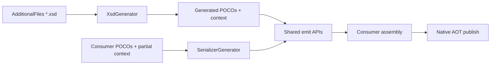

# Source generation

Part of the [XmlEssentials spec](README.md).

Context types and `[XmlSerializable]` / `[XmlSourceGenerationOptions]` signatures: [XmlSerializer](07-api-serializer.md#type-info--context).

## Serialization vs Metadata (STJ terms)

STJ’s source generator has two modes (`JsonSourceGenerationMode`), and XmlEssentials uses the same split (`XmlSourceGenerationMode`) with the same behaviour. The generator emits **metadata**; the one runtime engine reads and writes from it. The design and the public API are in [single engine: generated metadata](25-single-engine-metadata.md).

| Mode | What the generator emits | Behaviour |
| --- | --- | --- |
| **Metadata** | For every listed and reached object type, an `XmlObjectInfoValues<T>` and one `XmlPropertyInfoValues<TValue>` per member: getter and setter delegates, the member's attributes as instances, the constructor's parameters and a delegate that calls it. No reflection. | The runtime engine reads and writes, with every option and feature the reflection resolver has. Native AOT-safe. |
| **Serialization** | A write-only fast path that calls `Utf8XmlWriter` directly. | Writes when the options are the ones it was compiled for. Otherwise, and on every read, `InvalidOperationException`: "The type info for 'T' was generated in XmlSourceGenerationMode.Serialization, which provides no property metadata. It can only write a type that has a write fast path, with the options it was compiled for. Use XmlSourceGenerationMode.Default or XmlSourceGenerationMode.Metadata." |
| **Default** | `Metadata | Serialization`: both. | The fast path writes when the options allow it, and the engine does everything else. Nothing is refused. |

The mode on `[XmlSerializable<T>]` overrides the context's mode for that type. There is no generated read code: reading is the engine's, as in System.Text.Json.

Both modes ship ([K41](01-identity-and-decisions.md#key-decisions)). Interceptors ([K42](01-identity-and-decisions.md#key-decisions)): when a context is in the compilation, intercept `XmlSerializer.Serialize<T>(value)` and `Deserialize<T>(input)` calls that pass no options argument and rewrite them to the type-info overload with `Context.Default.T`. The interceptor takes its parameter type, `ref` kind and return type from the intercepted overload, so every input kind (string, character span, UTF-8 span, sequence, stream, `ref Utf8XmlReader`, `XmlDocument`, `XmlElement`, `XmlNode`) and a value-type `T` compile. A call that passes options, even `null`, is not intercepted. The document element of a generated type info follows the same rule as the reflection resolver (`[XmlRoot]` name and namespace, else the type name under the naming policy and `DefaultNamespace`), because the same binder creates it.

## Project

- Path: `src/CloudNimble.XmlEssentials.SourceGeneration/`
- TFM: `netstandard2.0` (Roslyn host compatibility).
- `IsPackable=false`. Packed **inside** `XmlEssentials`.
- `IsSourceGeneratorProject=true` (must be excluded from `IsPrimaryProject` so props do not `GeneratePackageOnBuild` as `XmlEssentials.SourceGeneration`).
- Incremental `IIncrementalGenerator`.
- `IsRoslynComponent=true`.
- `Microsoft.CodeAnalysis.CSharp` 4.* (Roslyn 4.14+ for net10/net11 SDK).
- No dependency on the runtime assembly at generator compile time if that creates a cycle; share **contracts via well-known type names** (the generator emits code that references `CloudNimble.Text.Xml.*`). Optional `CloudNimble.XmlEssentials.SourceGeneration.csproj` `ProjectReference` to the runtime with `ReferenceOutputAssembly=false` is **not** required.

## Nupkg layout

```
XmlEssentials.{version}.nupkg
  lib/net10.0/CloudNimble.XmlEssentials.dll
  lib/net10.0/CloudNimble.XmlEssentials.xml
  lib/net11.0/CloudNimble.XmlEssentials.dll
  lib/net11.0/CloudNimble.XmlEssentials.xml
  analyzers/dotnet/cs/CloudNimble.XmlEssentials.SourceGeneration.dll
  analyzers/dotnet/roslyn4.14/cs/CloudNimble.XmlEssentials.SourceGeneration.dll
  README.md
  LICENSE
```

No package icon. The package is **not** a developmentDependency. Consumers get the library + the analyzer automatically. `PrivateAssets` is not required (STJ-style same-package generator).

Primary library csproj:

```xml
<ItemGroup>
  <ProjectReference Include="..\CloudNimble.XmlEssentials.SourceGeneration\CloudNimble.XmlEssentials.SourceGeneration.csproj"
                    ReferenceOutputAssembly="false"
                    OutputItemType="Analyzer"
                    SetTargetFramework="TargetFramework=netstandard2.0" />
</ItemGroup>
<ItemGroup>
  <None Include="$(OutputPath)..\..\CloudNimble.XmlEssentials.SourceGeneration\$(Configuration)\netstandard2.0\CloudNimble.XmlEssentials.SourceGeneration.dll"
        Pack="true"
        PackagePath="analyzers/dotnet/cs;analyzers/dotnet/roslyn4.14/cs"
        Visible="false" />
</ItemGroup>
```

(Exact `$(OutputPath)` may use `TargetDir` of the referenced generator; the contract is both analyzer folders get the same DLL.)

## Generator behavior

1. Find partial classes inheriting `XmlSerializerContext` with `[XmlSerializable<T>]`.
2. Walk T's closure (properties, fields, collection elements, derived types, constructor params).
3. Emit `public static TContext Default { get; }` and `XmlTypeInfo<T>` properties (`Default.Person`).
4. For every object type, emit its metadata (`XmlObjectInfoValues<T>` handed to `XmlMetadataServices.CreateObjectInfo`). In **Default** and **Serialization** mode, also emit the write fast path for each type that can have one, as the `SerializeHandler` of that metadata. No generated code reads XML.
5. Diagnostics (not warnings-as-silent-skip):
   - XMLXE001: type not partial / not inheriting context
   - XMLXE002: truly unsupported types (open generics that cannot close, `IntPtr`, pointers). **Do not fire** on `Dictionary<,>` maps, `[XmlMixed]`, `[XmlExtensionData]` bags, or `IAsyncEnumerable` at the `SerializeAsyncEnumerable` entry point.
   - XMLXE003: attribute mapping on complex type
   - XMLXE004: multiple `[XmlText]`
   - XMLXE005: ambiguous constructors (two marked `[XmlConstructor]`, or, with none marked, two public constructors that bind the same number of members)
   - Constructor choice follows the reflection resolver: the marked constructor, else the public one with the most parameters among those whose every parameter is named like a member. A constructor that is not accessible from the context is called through `[UnsafeAccessor]`. XMLXE002 is also reported when no constructor can be used: a parameter no member fills has no default, or a class has no parameterless constructor and none that binds.
   - XMLXE015: a text member (`[XmlText]`, `[XmlCData]`) whose type is not a single value and has no `[XmlConverter]`.
   - XMLXE017: a required member is marked `[XmlIgnore(Condition = WhenReading)]`, so it would never be read.
   - XMLXE006: invalid XML name after policy
   - XMLXE007: `System.Xml.Serialization.XmlIncludeAttribute` present on this type graph (class or member). Message: use `[XmlDerivedType]`. Also diagnose our `[XmlInclude]` applied to a **type** (invalid target). Looking at BCL `XmlIncludeAttribute` on the **consumer** compilation is allowed and required; the runtime library still has zero BCL XML references.
   - XMLXE008, XMLXE009, XMLXE014 and XMLXE016 are retired and their numbers are not reused. They reported derived types, a converter on a member, mixed content and populating as things generated code could not do. The runtime engine does all four from the metadata.

`[XmlSourceGenerationOptions]` is a **default seed**; context ctor `XmlSerializerOptions` win. `GenerationMode` chooses what is generated, and every other property of the attribute is copied to the options of `Default`. `IgnoreReadOnlyFields` and `IgnoreReadOnlyProperties` turn the write fast path off, because it writes every member it was compiled with; the context then writes from the metadata. Where a discriminator is written is not an option: it is set on the type, with `[XmlPolymorphic]` ([07](07-api-serializer.md#type-info--context)).

**A generated context gives the result the reflection resolver gives, for every option.** The options are applied when the type info is created, by the same binder, so nothing is compiled in and nothing is refused. `XmlSerializerGeneratedParityTests` and `XmlSerializerGeneratedOptionsTests` run each case through a generated context and through the reflection resolver and require one result.

**The write fast path is used only when it would write what the engine writes.** `XmlMetadataServices.CanUseSerializeHandler` decides when the type info is created:

- The options' element and attribute naming policies, `DefaultPropertyMapping`, `DefaultCollectionMapping` and `IncludeFields` equal what the context was compiled with. `IgnoreReadOnlyProperties` and `IgnoreReadOnlyFields` are off. `DefaultIgnoreCondition` is not `WhenWritingNullReference`, and `CharHandling`, `UtcOffsetHandling` and `MemberOrder` have their default values. There is no `ReferenceHandler`. The options hold no converter for the type or for a scalar type the fast path writes directly.
- A type gets no fast path, and is written from the metadata, when it or one of its members declares derived types (or a member's type or item type does), a member has `[XmlConverter]`, it has mixed content or extension data, a member is not accessible from the context, or two members in its hierarchy have the same C# name. `TypeGraphWalker.FastPathBlocked` records this. There is no diagnostic: the type works.
- In `Serialization` mode such a type has neither a fast path nor metadata, so it can be neither written nor read, as in System.Text.Json (probed). The message says what a serialization-only type info can do.
- The fast path reads `DefaultIgnoreCondition` (and `[XmlIgnore(Condition = …)]`), `NumberHandling` and `RespectNullableAnnotations` from the options as it runs.

**Members of the same name** in a type and its base types follow System.Text.Json's rules, in `XmlObjectBinder.CreateModels`, for both resolvers ([object mapping](09-object-mapping.md#members-of-the-same-name)).

**A context answers for the types it lists, the types it reaches, and types whose converter exists already.** The walker lists every type reachable from a listed type, through members (inherited ones too), collections and dictionaries at any depth: object types get generated metadata, and collections, dictionaries, enumerations and nullable values get an entry that creates their type info with every type argument named (`XmlMetadataServices.CreateCollectionInfo`, `CreateArrayInfo`, `CreateDictionaryInfo`, `CreateEnumInfo`, `CreateNullableInfo`). Types whose converter exists already are the built-in scalars and their nullable forms, the XML values, `object`, and a type the caller supplied a converter for; `XmlMetadataServices.GetBuiltInTypeInfo` answers for those. For any other type `GetTypeInfo` returns null, so the next resolver in `TypeInfoResolverChain` is asked and a type nobody lists is `NotSupportedException`. That includes a collection, a dictionary or an enumeration that no listed type uses: list it on the context, as an array type can be too. A context never maps members through reflection and never closes a generic type at run time, which Native AOT cannot do for a value-type argument; `XmlAotPublishTests` proves it for a dictionary, a queue, a set, an immutable array, an array, a collection with no setter that is marked to be populated, an `XmlElement` and an `object` member. The metadata of a collection member names its item type (`XmlMetadataServices.CreateCollectionPropertyInfo`, `CreateArrayPropertyInfo`), so the runtime library creates the collection the reflection resolver creates.

XSD files as `AdditionalFiles` are a **second generator class in this same analyzer DLL**. They emit POCOs + context + metadata and the write fast path via shared emit APIs — they do **not** depend on seeing another generator’s output in the same compilation. Details: [11](11-xsd-source-generation.md).

## Pipeline



## Internal types

The generator emits into the **consuming compilation**. Internal POCOs **in that compilation** are fair game. `InternalsVisibleTo` friend assemblies are **not** automatically in the compilation — only types the generator actually sees as symbols in this compilation. No public-only restriction. This is an explicit improvement over BCL `XmlSerializer`.

---

[Index](README.md) · [Previous: Object mapping](09-object-mapping.md) · [Next: XSD source generation](11-xsd-source-generation.md)
